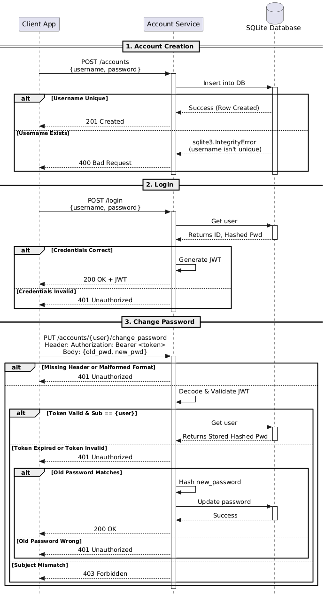

# account-service

Microservice for creating user accounts, logging in, authentication, and changing passwords.

- **Account Creation** (`POST /accounts`): Registers a new user.
- **User Login** (`POST /login`): Authenticates credentials and returns a JWT access token.
- **Password Management** (`PUT /accounts/<username>/change_password`): Updates an existing user's password.

## Requesting Data

To interact with the service, send HTTP requests (POST or PUT) with a JSON body. If user is accessing protected routes like password changes, user must include the JWT token in the Authorization header.

```python
# Setup
import requests
import jwt

# POST /accounts
payload = {
    "username": "abc",
    "password": "mypassword123"
}
response = requests.post("http://127.0.0.1:6900/accounts", json=payload)

# POST /login
payload = {
    "username": "abc",
    "password": "mypassword123"
}
response = requests.post("http://127.0.0.1:6900/login", json=payload)

# PUT /accounts/<username>/change_password
token = response.json().get("access_token")  # get token from login
headers = {"Authorization": f"Bearer {token}"}
payload = {
    "old_password": "mypassword123",
    "new_password": "updatedpassword123"
}
response = requests.put("http://127.0.0.1:6900/accounts/abc/change_password", json=payload, headers=headers)
```

## Receiving Data

The microservice always responds with a JSON object. To receive and use this data, user must parse the response body and check the HTTP status code to ensure the operation was successful.

### POST /accounts

```json
{
  "ok": true,
  "username": "abc",
  "message": "Account created."
}
```

- 201 - account created successfully

```json
{
  "ok": false,
  "error": "Username and password are required"
}
```

- 400 - Missing username or password

```json
{
  "ok": false,
  "error": {"code": "USER_EXISTS", "message": f"The username '{username}' already exists."}
}
```

- 400 - USER_EXISTS (user already exists)

```json
{
  "ok": false,
  "error": {
    "code": "CREATION_ERROR",
    "message": "Something went wrong while creating the account."
  }
}
```

- 500 - CREATION_ERROR

Example call:

```python

import requests

payload = {
    "username": "abc",
    "password": "mypassword123"
}

response = requests.post(f"http://127.0.0.1:6900/accounts", json=payload)

print(f"Status Code: {response.status_code}")
print(f"Response cBody: {response.json()}")

```

### POST /login

```json
{
  "ok": true,
  "access_token": "<token>",
  "token_type": "Bearer"
}
```

- 200 - logged in successfully

```json
{
  "ok": false,
  "error": {
    "code": "INVALID_INPUT",
    "message": "Username and password are required."
  }
}
```

- 400 - Missing username or password

```json
{
  "ok": false,
  "error": {
    "code": "INVALID_CREDENTIALS",
    "message": "Invalid credentials."
  }
}
```

- 401 - INVALID_CREDENTIALS(password doesn't match)

```json
{
  "ok": false,
  "error": {
    "code": "INVALID_CREDENTIALS",
    "message": "Invalid credentials."
  }
}
```

- 404 - INVALID_CREDENTIALS(user wasn't found)

```json
{
  "ok": false,
  "error": {
    "code": "LOGIN_ERROR",
    "message": "Something went wrong while logging in."
  }
}
```

- 500 - LOGIN_ERROR

Example call:

```python

import jwt
import requests

payload = {
    "username": "abc",
    "password": "mypassword123"
}

JWT_SECRET = "SUPER_SECRET_ASDFASDFASDFASDEWQER"

response = requests.post(f"http://127.0.0.1:6900/login", json=payload)

print(f"Status Code: {response.status_code}")
print(f"Response Body: {response.json()}")

if response.status_code == 200:
  body = response.json()
  access_token = body.get("access_token")

  decoded_access_token = jwt.decode(access_token, JWT_SECRET,
                                    algorithms=["HS256"])
  print(f"decoded jwt payload: {decoded_access_token}")

```

### PUT /accounts/<username>/change_password (e.g. PUT /accounts/abc/change_password)

```json
{
  "ok": true,
  "username": "abc",
  "message": "Password updated."
}
```

- 200 - password updated successfully

```json
{
  "ok": false,
  "error": "Old and new passwords are required."
}
```

- 400 - If the old password or the new password value is missing

```json
{
  "ok": false,
  "message": "Unauthorized. Please log in."
}
```

- 401 - If there is no header or the header is not in JWT format

```json
{
  "ok": false,
  "message": "The token is expired. Please log in again."
}
```

- 401 - If the token is expired

```json
{
  "ok": false,
  "message": "The token is invalid."
}
```

- 401 - The token is invalid

```json
{
  "ok": false,
  "error": { "code": "INVALID_CREDENTIALS", "message": "Invalid credentials." }
}
```

- 401 - INVALID_CREDENTIALS (old_pwd doesn't match)

```json
{
  "ok": false,
  "message": "Username does not match the current account. You are not allowed to modify this account's password."
}
```

- 403 - Username does not match the current account

```json
{
  "ok": false,
  "error": { "code": "USER_NOT_FOUND", "message": "User not found." }
}
```

- 404 - USER_NOT_FOUND

```json
{
  "ok": false,
  "error": {
    "code": "UPDATE_ERROR",
    "message": "Something went wrong while updating the password."
  }
}
```

- 500 - UPDATE_ERROR

Example call:

```python

import jwt
import requests

access_token = None
decoded_access_token = None

login_payload = {
    "username": "abc",
    "password": "mypassword123"
}

payload = {
    "old_password": "mypassword123",
    "new_password": "updatedpassword123"
}

JWT_SECRET = "SUPER_SECRET_ASDFASDFASDFASDEWQER"

login_response = requests.post(f"http://127.0.0.1:6900/login", json=login_payload)
if login_response.status_code == 200:
  body = login_response.json()
  access_token = body.get("access_token")

  decoded_access_token = jwt.decode(access_token, JWT_SECRET,
                                    algorithms=["HS256"])

if access_token and decoded_access_token:
    login_username = decoded_access_token.get("sub")
    login_headers = {
        "Authorization": f"Bearer {access_token}"
    }

    response = requests.put(
        f"http://127.0.0.1:6900/accounts/{login_username}/change_password",
        json=payload, headers=login_headers)
    print(f"Status Code: {response.status_code}")
    print(f"Response Body: {response.json()}")

```

## UML Sequence Diagram



---

# Development Setup

## Run (Windows ps script)

to test account creation in powershell

```

Invoke-RestMethod `
-Uri http://127.0.0.1:6900/accounts`
-Method POST `
-ContentType "application/json"`
-Body '{"username":"User123","password":"Pass123"}'

```

to test changing password in powershell

```

Invoke-RestMethod `
-Uri http://127.0.0.1:6900/accounts/User123/change_password`
-Headers @{ Authorization = "Bearer <token>" } `
-Method PUT `
-ContentType "application/json"`
-Body '{"old_password":"Pass123","new_password":"NewPass456"}'

```

## Environment Setup

### 1.) Create a virtual environment

Type this in your terminal (on windows)

```

py -m venv .venv

```

### 2.) Activate It

activate the virtual environment with this

```

.\.venv\Scripts\Activate.ps1

```

### 3.) Install packages from requirements.txt (no packages required yet)

Instead of installing packages individually, you can install them from the requirements file I created

```

pip install -r requirements.txt

```

If you want to add more packages to the environment for some reason, you can do it like this:

```

python -m pip install <package we need>

```

...then add it to the requirements.txt file:

```

python -m pip freeze > requirements.txt

```

### Bills note:

I had a weird issue where vscode wouldnt use the correct interpreter for my virtual environment. If this happens to you,

1. press `Ctrl + Shift + P`
2. Run Python: Select Interpreter
3. Browse to `.\.venv\Scripts\python.exe`

## Running the App

Once you are in your virtual environment using `.\.venv\Scripts\Activate.ps1`, you can run the app by typing:

````

python database.py

```

## how to test account creation and login

to test account creation in powershell:
```

Invoke-RestMethod `  -Uri http://127.0.0.1:6900/accounts`
-Method POST `  -ContentType "application/json"`
-Body '{"username":"User123","password":"Pass123"}'

```

to test login in powershell
```

Invoke-RestMethod `  -Uri http://127.0.0.1:6900/login`
-Method POST `  -ContentType "application/json"`
-Body '{"username":"User123","password":"Pass123"}'

```

to test a bad login in powershell:
```

Invoke-RestMethod `  -Uri http://127.0.0.1:6900/login`
-Method POST `  -ContentType "application/json"`
-Body '{"username":"User123","password":"chungus"}'

```

```
````
