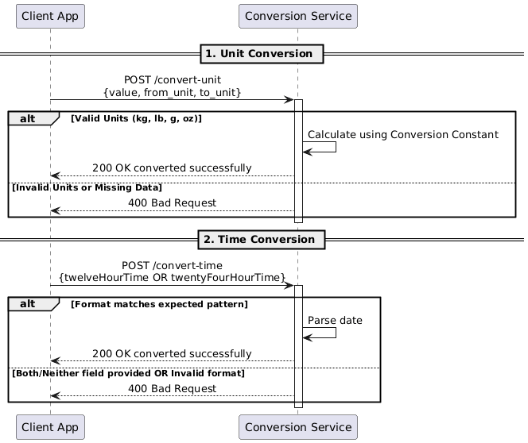

# unit-conversion-service

Microservice for converting mass units (kg <-> lb, g <-> oz) and translating time between 12-hour and 24-hour formats.

- **Convert Unit** (`POST /convert-unit`): Convert units.
- **Convert Time** (`POST /convert-time`): Convert time format.

## Requesting Data

To request a conversion, send an HTTP POST request to the appropriate endpoint with a JSON body containing the values to be transformed.

### Setup

```python
import requests
```

### POST /convert-unit

```python
payload = {
    "value": 150,
    "from_unit": "lb",
    "to_unit": "kg"
}
response = requests.post("http://127.0.0.1:6901/convert-unit", json=payload)
```

### POST /convert-time

```python
payload = {
    "twelveHourTime": "2:30 PM"
}
response = requests.post("http://127.0.0.1:6901/convert-time", json=payload)
```

## Receiving Data

The service returns a JSON object. User should check the HTTP status code (200 for success) and then access the specific keys in the dictionary. Unit conversions provide a rounded_val for convenience, while time conversions return both formats for comparison.

### POST /convert-unit

```json
{
  "original_val": 150,
  "converted_val": 68.0388555,
  "rounded_val": 68.04,
  "from_unit": "lb",
  "to_unit": "kg",
  "message": "Converted successfully!"
}
```

- 200 - converted successfully
- 400 - invalid body or TYPE_ERROR

### POST /convert-time

```json
{
  "ok": true,
  "twelveHourTime": "2:30 PM",
  "twentyFourHourTime": "14:30"
}
```

- 200 - converted successfully
- 400 - invalid body or time format

### Example call

```python
# POST /convert-unit
payload = {
    "value": 150,
    "from_unit": "lb",
    "to_unit": "kg"
}
response = requests.post("http://127.0.0.1:6901/convert-unit", json=payload)
body = response.json()
rounded_val = body.get("rounded_val")

# POST /convert-time
payload = {
    "twelveHourTime": "2:30 PM"
}
response = requests.post("http://127.0.0.1:6901/convert-time", json=payload)
body = response.json()
twenty_four_hr_time = body.get("twentyFourHourTime")
```

## UML Sequence Diagram



---

## Environment Setup (Windows)

### 1.) Create a virtual environment

Type this in your terminal (on windows)

```
py -m venv .venv
```

### 2.) Activate It

activate the virtual environment with this

```
.\.venv\Scripts\Activate.ps1
```

### ~~3.) Install packages~~

~~install Flask in your virtual environment (this installation is local to your project's virtual environment)~~

```
python -m pip install Flask
```

### 3.) Install packages from requirements.txt

Instead of installing packages individually, you can install them from the requirements file I created

```
pip install -r requirements.txt
```

If you want to add more packages to the environment for some reason, you can do it like this:

```
python -m pip install <package we need>
```

...then add it to the requirements.txt file:

```
python -m pip freeze > requirements.txt
```

### Bills note:

I had a weird issue where vscode wouldnt use the correct interpreter for my virtual environment. If this happens to you,

1. press `Ctrl + Shift + P`
2. Run Python: Select Interpreter
3. Browse to `.\.venv\Scripts\python.exe`

## Running the App

Once you are in your virtual environment using `.\.venv\Scripts\Activate.ps1`, you can run the app by typing:

```
flask --app conversion-service run
```

or

```
python conversion-service.py
```

then, in your web browser, go to `localhost:6901`
